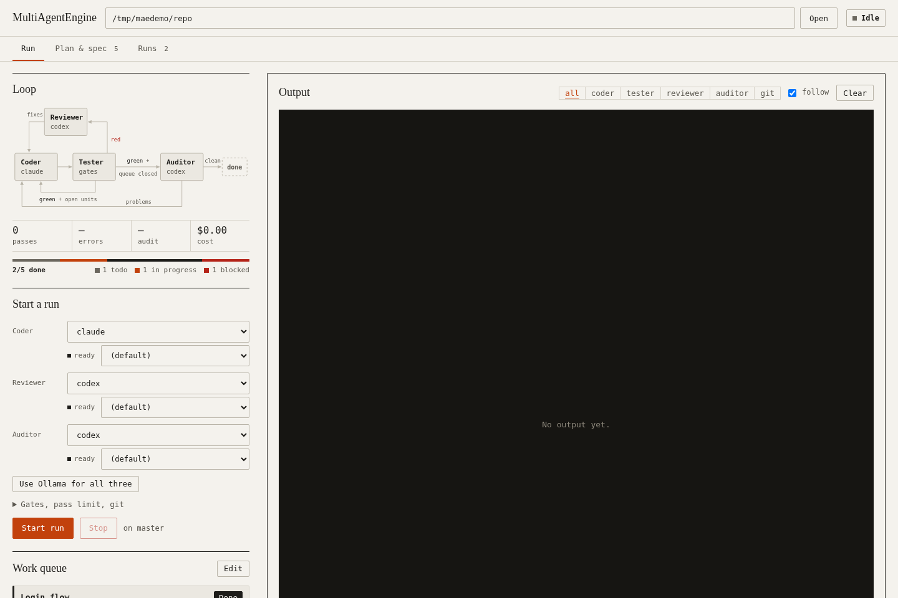

<div align="center">

# MultiAgentEngine

**A loop of coding agents that implements, tests and audits your spec until it is done.**

[](https://github.com/MiltonJoel/MultiAgentEngine/actions/workflows/tests.yml)
[](https://miltonjoel.github.io/MultiAgentEngine/)


[](https://github.com/MiltonJoel/MultiAgentEngine/blob/master/LICENSE)

**[Documentation](https://miltonjoel.github.io/MultiAgentEngine/)** · **English** · [Español](https://github.com/MiltonJoel/MultiAgentEngine/blob/master/README.md)

</div>

MultiAgentEngine (`mae`) is an orchestrator built on [LangGraph](https://github.com/langchain-ai/langgraph)
that drives coding agents — the `claude` CLI, the `codex` CLI, or a **free model** (local through
Ollama, or any OpenAI-compatible API) — against a repository until an architecture spec is implemented,
tested and audited.

You write the spec and the work queue. The engine runs the agents, validates every pass with
deterministic gates (tests, lint), keeps the queue up to date, takes a git checkpoint per pass, and stops
when nothing is left open and the audit comes back clean.

**No paid subscription needed:** with `mae --free` all three roles use a local model through
[Ollama](https://ollama.com) — no account, no key, no cost.



## Features

- **Evaluator-optimizer loop** — coder → tester → reviewer (on red) or auditor (on green) → coder, until the
  queue is closed. The auditor reopens `DONE` units that do not meet the spec.
- **Deterministic gates** — pytest and ruff by default, or any command (`npm test`, `tsc`, `eslint`, `go vet`…).
- **Any model in any role** — `claude`, `codex`, Ollama or an OpenAI-compatible API; mix them per role.
- **Safe by design** — one branch and one commit per pass, secrets kept out of commits, file tools confined to
  the repo, API keys protected, clean `SIGTERM`/Ctrl-C handling.
- **Observable** — a JSONL log per run with timings, tokens and cost; exit codes designed for CI.
- **Local dashboard** (`mae-ui`) — edit the queue and spec, start and stop runs, watch them live.

## Quick start

Python 3.10+ on Linux or macOS (on Windows, inside WSL), plus at least one model provider: Ollama with a
downloaded model, an OpenAI-compatible endpoint, or the logged-in `claude` / `codex` CLIs.

```bash
# 1. Install the engine (once)
pipx install git+https://github.com/MiltonJoel/MultiAgentEngine.git

# 2. Prepare the project you want to build
mkdir -p ~/code/myproject/.mae && cd ~/code/myproject
git init -q 2>/dev/null; echo ".mae/runs/" >> .gitignore

cat > .mae/spec.md <<'EOF'
# Spec
A FastAPI service with email/password login and a limit of 100 requests/minute
per user. Every endpoint has a pytest test.
EOF

cat > .mae/plan.md <<'EOF'
<!-- ENGINE-STATUS
Login flow: TODO
Rate limiting: TODO
-->
EOF

# 3. Run (add --free to use a local Ollama model for every role)
mae

# 4. Review the result on its branch — the exact command is printed at the end
```

To ask for more work, add or reopen a line in the `ENGINE-STATUS` block and run `mae` again. Prefer a
browser? `mae-ui --repo ~/code/myproject` opens the dashboard.

## Documentation

The full documentation lives at **<https://miltonjoel.github.io/MultiAgentEngine/>**:

- [Getting started](https://miltonjoel.github.io/MultiAgentEngine/getting-started/) — install, the two files, first run
- [Plan and spec](https://miltonjoel.github.io/MultiAgentEngine/guide/plan-and-spec/) — the status block and how to add work
- [Free models](https://miltonjoel.github.io/MultiAgentEngine/guide/free-models/) — Ollama and OpenAI-compatible APIs
- [CI, Docker and signals](https://miltonjoel.github.io/MultiAgentEngine/guide/ci/) — running unattended
- [The loop](https://miltonjoel.github.io/MultiAgentEngine/concepts/loop/) — how the roles fit together
- Reference: [command line](https://miltonjoel.github.io/MultiAgentEngine/reference/cli/) ·
  [configuration](https://miltonjoel.github.io/MultiAgentEngine/reference/config/) ·
  [run log](https://miltonjoel.github.io/MultiAgentEngine/reference/run-log/) ·
  [runners and prompts](https://miltonjoel.github.io/MultiAgentEngine/reference/runners/)
- [Troubleshooting](https://miltonjoel.github.io/MultiAgentEngine/troubleshooting/)

The same pages are in [`docs/`](https://github.com/MiltonJoel/MultiAgentEngine/tree/master/docs) if you are reading this offline.

## Security

The agents **run commands on your machine** with your permissions. Before pointing the engine at a spec,
plan or repository you did not write, read [SECURITY.md](https://github.com/MiltonJoel/MultiAgentEngine/blob/master/SECURITY.md) — it covers the threat model and how
to report a vulnerability privately.

## Contributing

```bash
git clone https://github.com/MiltonJoel/MultiAgentEngine.git && cd MultiAgentEngine
python3 -m venv .venv && source .venv/bin/activate
pip install -e ".[dev]"
ruff check . && mypy && python -m pytest -q --cov
```

See [CONTRIBUTING.md](https://github.com/MiltonJoel/MultiAgentEngine/blob/master/CONTRIBUTING.md) for the workflow and the docs setup, and [CHANGELOG.md](https://github.com/MiltonJoel/MultiAgentEngine/blob/master/CHANGELOG.md)
for the history of changes.

## License

[MIT](https://github.com/MiltonJoel/MultiAgentEngine/blob/master/LICENSE) © 2026 MiltonJoel
