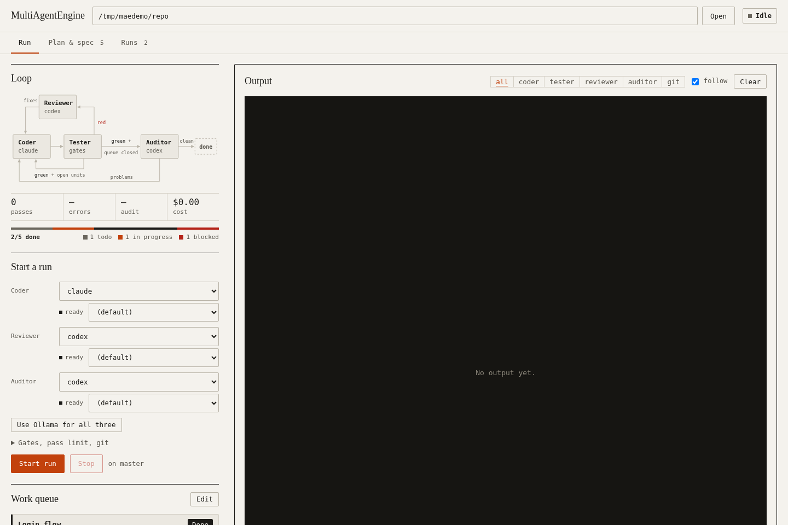

<div align="center">

# MultiAgentEngine

**Un bucle de agentes de programación que implementa, prueba y audita tu especificación hasta terminarla.**

[](https://github.com/MiltonJoel/MultiAgentEngine/actions/workflows/tests.yml)
[](https://miltonjoel.github.io/MultiAgentEngine/)


[](https://github.com/MiltonJoel/MultiAgentEngine/blob/master/LICENSE)

**[Documentación (en inglés)](https://miltonjoel.github.io/MultiAgentEngine/)** · [English](https://github.com/MiltonJoel/MultiAgentEngine/blob/master/README.en.md) · **Español**

</div>

MultiAgentEngine (`mae`) es un orquestador sobre [LangGraph](https://github.com/langchain-ai/langgraph)
que dirige agentes de programación — la CLI `claude`, la CLI `codex` o un **modelo gratuito** (local con
Ollama, o cualquier API compatible con OpenAI) — contra un repositorio hasta que una especificación de
arquitectura queda implementada, testeada y auditada.

Tú escribes la especificación y la cola de trabajo. El motor ejecuta los agentes, valida cada pasada con
gates deterministas (tests, lint), mantiene la cola al día, guarda un checkpoint de git por pasada y se
detiene cuando no queda nada abierto y la auditoría sale limpia.

**No necesitas ninguna suscripción de pago:** con `mae --free` los tres roles usan un modelo local a
través de [Ollama](https://ollama.com) — sin cuenta, sin clave, sin coste.



## Características

- **Bucle evaluador-optimizador** — coder → tester → revisor (si falla) o auditor (si pasa) → coder, hasta
  cerrar la cola. El auditor reabre las unidades `DONE` que no cumplen la especificación.
- **Gates deterministas** — pytest y ruff por defecto, o cualquier comando (`npm test`, `tsc`, `eslint`,
  `go vet`…).
- **Cualquier modelo en cualquier rol** — `claude`, `codex`, Ollama o una API compatible con OpenAI;
  mézclalos por rol.
- **Seguro por diseño** — una rama y un commit por pasada, secretos fuera de los commits, herramientas de
  archivos confinadas al repo, claves de API protegidas, `SIGTERM`/Ctrl-C limpios.
- **Observable** — log JSONL por ejecución con tiempos, tokens y coste; códigos de salida pensados para CI.
- **Panel web local** (`mae-ui`) — editar la cola y la especificación, lanzar y detener ejecuciones, verlas
  en vivo.

## Inicio rápido

Python 3.10+ en Linux o macOS (en Windows, dentro de WSL), y al menos un proveedor de modelo: Ollama con
un modelo descargado, un endpoint compatible con OpenAI, o las CLIs `claude` / `codex` con sesión iniciada.

```bash
# 1. Instalar el motor (una sola vez)
pipx install git+https://github.com/MiltonJoel/MultiAgentEngine.git

# 2. Preparar el proyecto que quieres construir
mkdir -p ~/code/myproject/.mae && cd ~/code/myproject
git init -q 2>/dev/null; echo ".mae/runs/" >> .gitignore

cat > .mae/spec.md <<'EOF'
# Spec
Un servicio FastAPI con login por email/contraseña y límite de 100 peticiones/minuto
por usuario. Cada endpoint tiene un test de pytest.
EOF

cat > .mae/plan.md <<'EOF'
<!-- ENGINE-STATUS
Login flow: TODO
Rate limiting: TODO
-->
EOF

# 3. Ejecutar (añade --free para usar un modelo local de Ollama en todos los roles)
mae

# 4. Revisa el resultado en su rama — el comando exacto se imprime al final
```

Para pedir más trabajo, añade o reabre una línea del bloque `ENGINE-STATUS` y vuelve a ejecutar `mae`.
¿Prefieres el navegador? `mae-ui --repo ~/code/myproject` abre el panel.

Los estados del bloque (`TODO`, `IN_PROGRESS`, `DONE`, `BLOCKED`) se escriben siempre en inglés y en
mayúsculas; el nombre de cada unidad puede estar en el idioma que quieras.

## Documentación

La documentación completa (en inglés) está en **<https://miltonjoel.github.io/MultiAgentEngine/>**:

- [Getting started](https://miltonjoel.github.io/MultiAgentEngine/getting-started/) — instalación, los dos archivos, la primera ejecución
- [Plan and spec](https://miltonjoel.github.io/MultiAgentEngine/guide/plan-and-spec/) — el bloque de estado y cómo añadir trabajo
- [Free models](https://miltonjoel.github.io/MultiAgentEngine/guide/free-models/) — Ollama y APIs compatibles con OpenAI
- [CI, Docker and signals](https://miltonjoel.github.io/MultiAgentEngine/guide/ci/) — ejecución desatendida
- [The loop](https://miltonjoel.github.io/MultiAgentEngine/concepts/loop/) — cómo encajan los roles
- Referencia: [línea de comandos](https://miltonjoel.github.io/MultiAgentEngine/reference/cli/) ·
  [configuración](https://miltonjoel.github.io/MultiAgentEngine/reference/config/) ·
  [log de ejecución](https://miltonjoel.github.io/MultiAgentEngine/reference/run-log/) ·
  [runners y prompts](https://miltonjoel.github.io/MultiAgentEngine/reference/runners/)
- [Troubleshooting](https://miltonjoel.github.io/MultiAgentEngine/troubleshooting/) — los mensajes del
  motor están en inglés; búscalos tal cual

Las mismas páginas están en [`docs/`](https://github.com/MiltonJoel/MultiAgentEngine/tree/master/docs) si lo lees sin conexión.

## Seguridad

Los agentes **ejecutan comandos en tu máquina** con tus permisos. Antes de usar el motor con
especificaciones, planes o repositorios que no son tuyos, lee [SECURITY.md](https://github.com/MiltonJoel/MultiAgentEngine/blob/master/SECURITY.md): explica el modelo
de amenazas y cómo reportar una vulnerabilidad de forma privada.

## Contribuir

```bash
git clone https://github.com/MiltonJoel/MultiAgentEngine.git && cd MultiAgentEngine
python3 -m venv .venv && source .venv/bin/activate
pip install -e ".[dev]"
ruff check . && mypy && python -m pytest -q --cov
```

Ver [CONTRIBUTING.md](https://github.com/MiltonJoel/MultiAgentEngine/blob/master/CONTRIBUTING.md) para el flujo de trabajo y la documentación, y
[CHANGELOG.md](https://github.com/MiltonJoel/MultiAgentEngine/blob/master/CHANGELOG.md) para el historial de cambios.

## Licencia

[MIT](https://github.com/MiltonJoel/MultiAgentEngine/blob/master/LICENSE) © 2026 MiltonJoel
