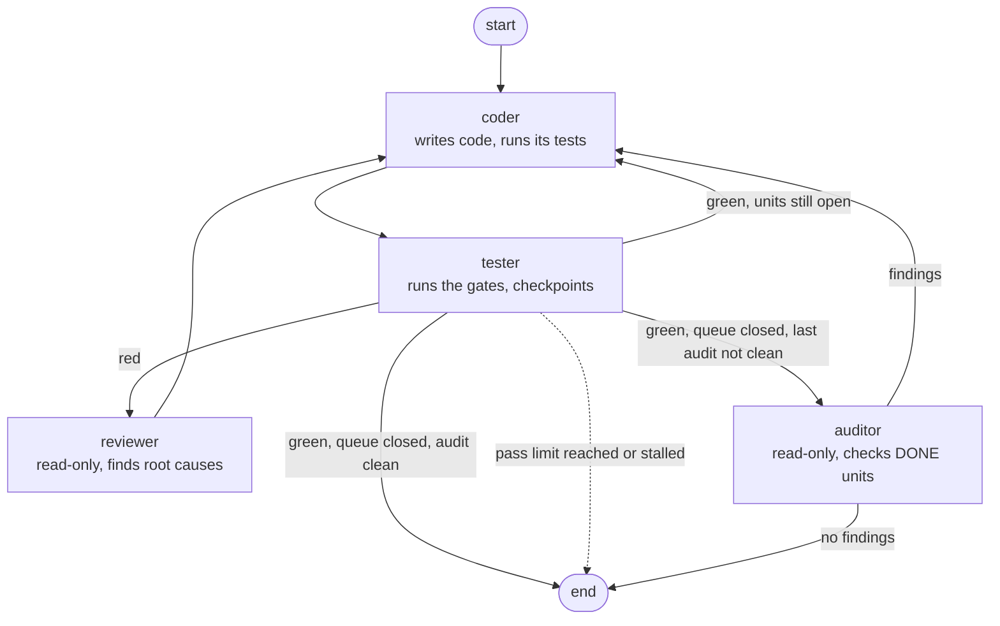

# The loop

The loop is the graph that `mae` runs: a coder writes code, a deterministic tester checks it, and reviewers and
an auditor send problems back to the coder until the plan is finished and the audit is clean. This page
describes each node, how the graph routes between them, and when the run stops.

## The graph



The graph is built in `engine/graph.py` (`build_graph`). It has four nodes, `coder`, `tester`, `reviewer` and
`auditor`, and three routing functions: `after_tests`, `after_review` and `after_audit`. The edge that leaves the
tester depends on the gates and on the plan's status block, not on a model's opinion.

The engine works in *passes*. A pass is one coder run followed by the tester. The `iteration` counter counts
coder passes, and `--max-iterations` limits them.

## The nodes

### Coder

The coder is the only node that writes to the repository (`engine/nodes/coder.py`). Its prompt is
`engine/prompts/coder.md`, filled with the spec, the plan, and the errors and findings from the last pass.
By default it runs on `claude`, which may edit files and run commands.

Its job is to work the open units of the plan. It fixes the errors from the tester first, then implements the
units marked `TODO` or `IN_PROGRESS`. Its prompt defines `DONE` as verified: the unit has code, tests that cover
the behaviour the spec requires, and a passing run of those tests. A unit that needs data, a network,
credentials or a human decision goes to `BLOCKED` with the reason. The coder runs only the tests of the unit it
is working on. The full suite is the tester's job.

Each pass has a budget of 5,400 seconds (90 minutes).

### Tester

The tester (`engine/nodes/tester.py`) calls no model. It runs the gates in order, one command each, and turns
their output into structured errors of the form `{file, line, description}`. It reports at most 20 errors per
pass.

Before the gates run, the tester checks the plan's status block. A `-->` inside a line, a second status block, a
misspelt state, or a unit that was open when the run started and has disappeared all become errors named
`plan: ...`. The pass is then red, so the coder fixes the plan before anything else.

Gate output is parsed in this order:

1. JSON, for `ruff` and `eslint`.
2. The text form `path:line[:col]: message`, which covers `pytest --tb=line`, `ruff`, `mypy`, `tsc`, compact
   `eslint`, `go vet` and `gcc`. The file part must contain a dot or a slash, so that timestamps and prose do not
   match.
3. If neither matches, the last 800 characters of the raw output, as one error with no file.

At startup, a default gate whose tool is not installed is skipped with a message. A configured gate whose tool is
missing stops the start. A gate that disappears or hangs during the run counts as red. A gate has a 900-second timeout, and the process group is killed when it expires.

After the gates, the tester writes a checkpoint commit for the pass, red or green. See
[Checkpoints](checkpoints.md).

A green build sets `tests_passed` and clears the findings from the last pass. A red build keeps the errors.

### Reviewer

The reviewer runs only when the build is red. It is read-only and, by default, runs on `codex`. Its prompt
(`engine/prompts/reviewer.md`) has the spec, the plan, the errors and the diff of the pass that just failed. The
diff is the difference between `HEAD~1` and the working tree, which after the checkpoint is the pass itself.

It returns the root causes as JSON:

```json
{"problems": [{"unit": "Login flow", "file": "app/auth.py", "line": 84,
               "description": "the lock is taken twice", "suggested_fix": "release it in finally"}]}
```

The findings go to the coder on the next pass. The reviewer never edits a file.

### Auditor

The auditor runs when the build is green and every unit is `DONE` or `BLOCKED`. It is read-only and, by default,
runs on `codex`. The coder grades its own work, so the auditor checks the work against the spec. It reads the
diff of the whole run, from the commit the run started on, and reports units marked `DONE` that are half-done,
contradict the spec, lack a test for a required behaviour, or claim an exit criterion that cannot be met.

Its scope is `focus`: the units that were open when the run started. Units from earlier runs are not audited
again.

After the auditor returns, `audit_node` in `engine/graph.py` calls `reopen_units`. For every finding that names a
unit in the plan, that unit changes from `DONE` to:

```text
Login flow: TODO — audit: the lock is taken twice
```

The note is the first finding's description, cut to 160 characters, with `-->` replaced by `→` so the status block
stays closed. `BLOCKED` units are never reopened. A finding with no unit name, or a name that matches no line, is
kept as a problem, but it reopens nothing. The coder then gets every finding.

The run logs a `reopen` event with the names of the units it reopened.

## Routing

The three routing functions decide the next node. Each checks its conditions in the order shown.

**`after_tests`** runs after the tester:

| Check | Result |
|---|---|
| `iteration` is at `max_iterations` | end (exit code 1) |
| `idle_passes` is at `IDLE_LIMIT` (2) | end (exit code 1), logged as `stalled` |
| `tests_passed` is false | `reviewer` |
| the plan is not finished (`TODO` or `IN_PROGRESS` remains) | `coder` |
| the last audit was not clean | `auditor` |
| the last audit was clean | end |

**`after_review`** runs after the reviewer. It ends the run when the pass limit is reached, and otherwise goes
to `coder`.

**`after_audit`** runs after the auditor. If there are findings and the pass limit is not reached, it goes to
`coder`. Otherwise it ends the run.

Because the audit is run again after each fix, the loop can cycle: coder, tester, auditor, coder and so on. Each
cycle is one or more passes, and each one counts against `max_iterations`.

## When the run stops

| Stop | Condition | Exit code |
|---|---|---|
| Clean | the plan is finished, the gates are green and the last audit is clean | `0`, or `2` with caveats (see below) |
| Pass limit | `iteration` reaches `max_iterations` | `1` |
| Stalled | two coder passes in a row change nothing | `1` |
| Failed | an agent or a checkpoint fails | `1` |
| Interrupted | Ctrl-C or `SIGTERM` | `130` or `143` |

`--max-iterations` defaults to 15, and the flag beats the `max_iterations` key in `.mae/config.json`. It is a
ceiling, not a target. It must be larger than the number of open units, because every unit normally takes at
least one pass and every audit that finds something adds more.

**Idle passes.** The coder counts a pass as idle when it changes no file and does not touch the plan. With git,
the tree is clean before each pass, so the pass is idle when the tree is still clean right after the coder
finishes. Without git, the engine compares a fingerprint of the files (path, size and modification time) before
and after the pass. Two idle passes in a row, which is
`IDLE_LIMIT`, end the run with the message `[engine] 2 coder passes in a row changed nothing — stopping`. This stops the
engine from paying for passes that do nothing. The stall check runs before the red-build check, so a stalled
red build also stops.

**Exit 2 with caveats.** A run where the plan and audit are clean can still exit `2` when some units are
`BLOCKED`, or when no gate ran, because then "green" checked nothing. The run prints `Needs a human look`. See
[the command line reference](../reference/cli.md) for the codes.

## Audit output and fail-closed parsing

The auditor and reviewer both return the same JSON shape, and the engine reads it strictly. A reply that cannot
be read is never a clean audit.

The parser (`engine/nodes/reviewer.py`) reads every `{"problems": [...]}` object in a reply, merging them. Models
often wrap JSON in prose or code fences, so the parser accepts both, but it refuses the following:

- a reply that is prose only, with no findings object;
- a findings object that is cut off or malformed. A `{"problems": ` start that fails to decode is an error, not
  something to skip;
- a `problems` value that is not a list of objects, such as `null`;
- nesting so deep that the decoder gives up.

Each of these becomes a single problem whose description starts with `unreadable reply:`. The audit is not clean,
so the run goes back to the coder.

**Restating an ambiguous reply.** A reply can have an empty findings list and still contain a lot of prose. Prose
can describe a real problem, and an empty list would hide it. When the prose outside the JSON is longer than
`MAX_CLEAN_PROSE` (120 characters, not counting whitespace and code fences), the engine asks the same agent once
to restate the reply as JSON. The restatement prompt contains only the previous reply. It does not include the
spec or the diff. The agent is told to put every problem into `problems`, or return `{"problems": []}` only if
the prose describes no problem.

The restated reply is parsed with the same strict rules. If it is still ambiguous, it is treated as unreadable.
The run logs the restatement as a separate call with the label `auditor-restate` or `reviewer-restate`.

## Diffs

The reviewer and the auditor both get the diff of the code they are reviewing.

- A diff of up to `FULL_DIFF_CHARS` (2,000 characters) goes into the prompt whole.
- A longer diff goes in as its `--stat` only, with a note telling the agent to open the changed files itself.
  Every runner can read the repository, so the agent reads only what it needs.
- Without git, or when nothing was committed, the prompt says that the diff is not available.

The reviewer's diff is the pass that just failed. The auditor's is everything the run changed, from the commit
the run started on.

## Related pages

- [Plan and spec](../guide/plan-and-spec.md) describes the status block the loop reads.
- [Checkpoints](checkpoints.md) describes the commits the tester writes after every pass.
- [Cost and limits](cost.md) says which roles run how often, and what each costs.
- [Roles, runners and prompts](../reference/runners.md) lists the runners each role can use.
