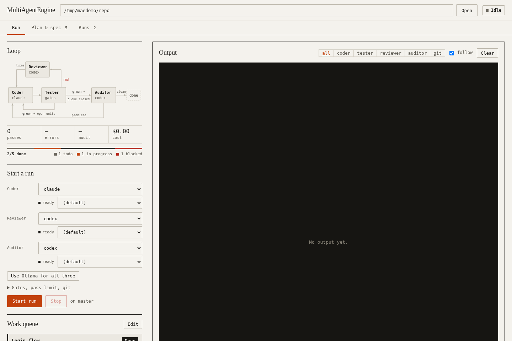
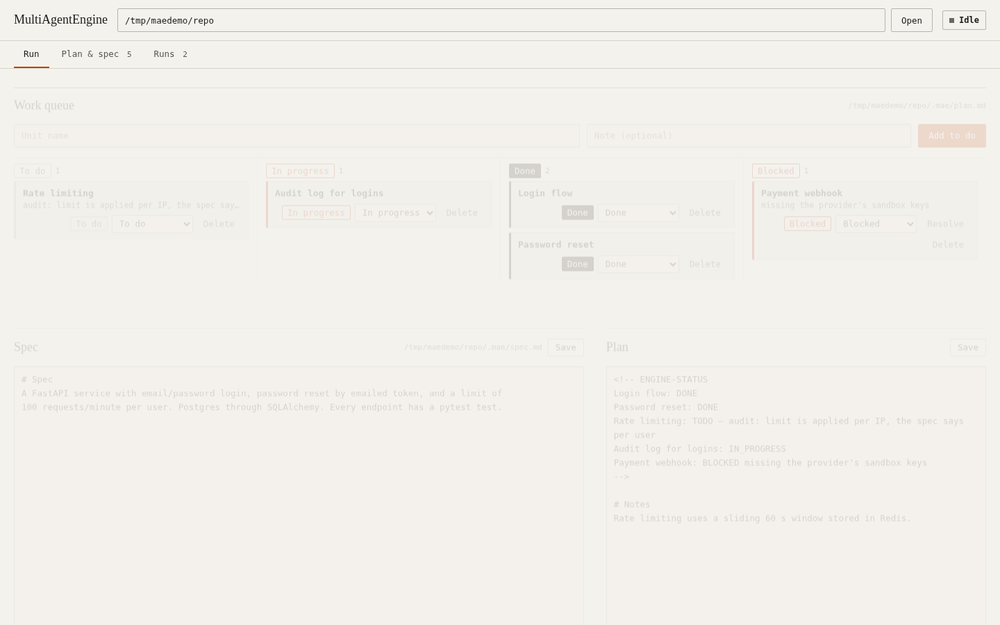

# Dashboard (`mae-ui`)

`mae-ui` is a local web page for the same engine. Use it to edit the spec and the work queue, start and stop
runs, watch a run live, and browse past runs and their checkpoint commits. It runs `mae` for you; it does not
replace it, and everything it does can also be done from the [command line](../reference/cli.md).

## Starting it

```bash
mae-ui --repo ~/code/myproject
```

It prints a URL and opens it in your browser:

```text
MultiAgentEngine UI: http://127.0.0.1:8765/?token=...#/home/you/code/myproject
(Ctrl-C to quit; a running engine is stopped too)
```

| Flag | Default | Meaning |
|---|---|---|
| `--repo DIR` | `.` | the repository to open first |
| `--port N` | `8765` | the port on `127.0.0.1` |
| `--no-browser` | off | print the URL instead of opening it |
| `--version` | | print the version and exit |

If the port is taken, `mae-ui` stops with `cannot listen on 127.0.0.1:8765: ... — try --port`. Use
`--port` with another number.

You can also open the page without `--repo`. It starts on a welcome screen where you paste the path of a
repository. A repository needs `.mae/spec.md` and `.mae/plan.md`. If either is missing, the editors can
create it from a starter template after you open the repository.

!!! warning "The URL is a credential"
    The `token` in the URL is what lets a page call the API. Do not paste the URL into a chat or a ticket, and
    do not share your screen while it is open. A new token is generated on every start.

Press Ctrl-C in the terminal to quit. If a run is in progress, it is stopped first, and then the server exits.

## The three tabs

The tabs are **Run**, **Plan & spec** and **Runs**. The Run tab is where you start.

### Run



The Run tab has these parts:

- **Loop.** A diagram of the graph (coder, tester, reviewer, auditor), with the active node lit while a run
  is going. Below it are four counters: **passes** (coder passes so far), **errors** (the tester's errors on the
  last pass), **audit** (the last audit's result) and **cost**. A progress bar shows the state of the work
  queue.
- **Start a run.** One row per role: **Coder**, **Reviewer** and **Auditor**. Each has a runner selector
  (`claude`, `codex`, `ollama`, `api`) and a second selector for the model or effort the runner takes. A runner
  that is not ready shows the reason under its selector, for example that its CLI is not on `PATH`. The
  **Use Ollama for all three** button sets every role to `ollama`.
- **Gates, pass limit, git.** A collapsed section with a text box for gate commands, one per line. A blank box
  means the repository's config or the defaults are used. It also has **Max coder passes**, **no gates at all**
  and **no git checkpoints**. These map to `--gate`, `--max-iterations` and `--no-git`.
- **Start run** and **Stop.** Stop sends the engine the same interrupt as Ctrl-C. The engine kills its agent,
  logs `aborted` and keeps the checkpoints made so far.

Beside the controls is the **Output** console, which shows the engine's output as it arrives.
The filter buttons show one role at a time (**all**, **coder**, **tester**, **reviewer**, **auditor**, **git**).
**follow** keeps the view at the newest line, and **Jump to latest** appears when you scroll away. **Clear**
empties the view only; the run keeps going. The console keeps the newest 20,000 lines in memory. The run log
keeps everything.

The **Work queue** card at the bottom of the tab shows the units. **Edit** opens the Plan & spec tab.

#### How a run is launched

When you press **Start run**, `mae-ui` starts the engine as a subprocess in the repository, with the same Python
interpreter that runs `mae-ui`. The console shows the command as `mae ...`. Each option becomes a flag:

| Setting in the page | Flag passed |
|---|---|
| a role's runner and model | `--agent coder=claude:opus` (one per role) |
| gate lines | `--gate <command>` for each line; `--gate ''` when **no gates at all** is checked |
| **Max coder passes** | `--max-iterations N` |
| **no git checkpoints** | `--no-git` |

Only one run can be in progress. Starting a second one fails with `a run is already in progress — stop it first`.
The engine's output is captured by `mae-ui` and streamed to the page. The run log is written in the repository
as usual, under `.mae/runs/`.

Run status shows in the Runs tab as one of `clean`, `needs review`, `finished with issues`, `aborted`, or
`running or killed` (a log with no finish event, such as one from a process that was killed).

### Plan & spec



This tab edits the three files the engine reads. None of the edits starts a run.

- **Work queue.** The units of the `ENGINE-STATUS` block, in one column per state: `TODO`, `IN_PROGRESS`,
  `DONE` and `BLOCKED`. Drag a unit to another column to change its state, or focus it and use the left and
  right arrow keys. On a touch screen, pick the state from the list on the unit. The form above the columns adds
  a unit with a name and an optional note, as a `TODO` line in the block. Lines the engine cannot read are listed
  above the columns, because the engine ignores them.
- **Spec.** An editor for `spec.md`. The engine reads the spec at the start of every pass, so a change applies
  from the next pass. It does not edit the spec itself.
- **Plan.** An editor for `plan.md`. Changes to the status block take effect on the next pass.
- **`.mae/config.json`.** An editor for the repository config. The page rejects text that is not a JSON object
  before it saves. See the [configuration reference](../reference/config.md) for the keys.

Each editor has its own **Save** button, and an **unsaved** marker shows which editors have changes.
**Ctrl+S** saves the editor you are in, or all unsaved editors when you press it outside one.

The engine checks the status block at startup and prints a `WARNING` for each problem it finds. During a run,
the tester reports the same problems as errors, which turns the pass red. See [Plan and spec](plan-and-spec.md).

### Runs

This tab lists the run logs in `.mae/runs/` of the open repository. Each entry shows its status, its number of
passes and its cost. Select one to see its timeline and the checkpoint commits on its branch, each with its
diff.

- **Refresh** reloads the list.
- **Clear** deletes this repository's run logs in `.mae/runs/`. The log of a run in progress is kept. The
  checkpoint commits are not touched.

## Security model

`mae-ui` runs code on your machine: starting a run executes the agents and the repository's gate commands. It
is built to be used only by you, from your own browser.

- **Local only.** The server listens on `127.0.0.1` and nothing else. It is not reachable from other machines on
  the network. Do not put it behind a reverse proxy or a tunnel that exposes it.
- **A token on every start.** Each launch generates a random token, and the page is given it in the URL. Every
  call to the API must send the token in an `X-MAE-Token` header. A call without the right token gets `403`.
  The comparison is done in constant time.
- **Host and Origin check.** A request whose `Host` header is not the loopback address and port of this server
  gets `403`, and so does a request whose `Origin` header (when the browser sends one) is not that same address.
  This blocks a web page on another site from using the server through DNS rebinding.
- **Page headers.** The page is served with a strict Content-Security-Policy, `X-Frame-Options: DENY`, and
  `Referrer-Policy: no-referrer`, so the token in the URL is not passed on to other sites.
- **Limits on requests.** A request body may be at most 4 MiB, and a client that stalls for 30 seconds is
  dropped.
- **One run at a time.** The server drives one engine process. Stop does not signal the whole process group,
  only the engine, which then stops its own children.

### API keys

`mae-ui` does not send your model key to an endpoint that a repository's config chose. When you open a
repository, the page checks each runner and lists that endpoint's models. Those checks send the key only to an
endpoint from your own environment, never to one from the repository's config. When you start a run, the key
goes to whatever endpoint the config names, and `mae` prints that host before the run starts. See
[Free models](free-models.md#key-handling) for the rules.

For the full threat model, see [Security](../security.md).
